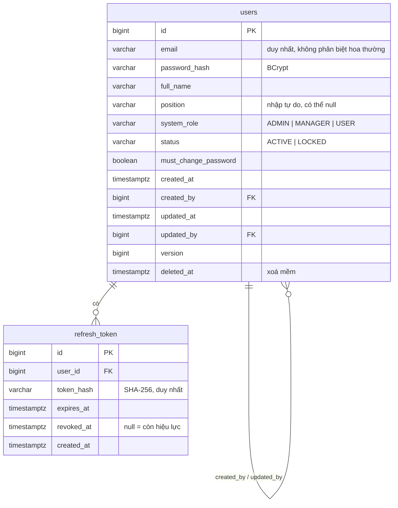

# ERD — Cơ sở dữ liệu

> **Stage 1 (auth) — đã chốt và có migration `V2__create_users.sql`.** Chỉ có `users` và `refresh_token`. Các bảng của stage sau thêm khi tới stage đó.
> Theo `stages/README.md`: nếu `stages/stage-N.md` khác ERD thì **ERD thắng**.
> Quy ước (`ARCHITECTURE.md` mục 5.1, 6): `snake_case`; khoá chính `BIGINT` identity; thời gian `timestamptz` (UTC); cột audit + `version` + `deleted_at` trên bảng nghiệp vụ.

## Sơ đồ

## `users`

| Cột | Kiểu | Ràng buộc | Ghi chú |
|---|---|---|---|
| `id` | BIGINT identity | PK | |
| `email` | VARCHAR(255) | NOT NULL | Duy nhất theo `lower(email)` (chỉ mục unique bên dưới) |
| `password_hash` | VARCHAR(100) | NOT NULL | BCrypt (60 ký tự), không bao giờ lưu mật khẩu thô |
| `full_name` | VARCHAR(100) | NOT NULL | |
| `position` | VARCHAR(100) | NULL | Vị trí, nhập tự do (ví dụ "Kế toán") |
| `system_role` | VARCHAR(20) | NOT NULL, CHECK IN (`ADMIN`,`MANAGER`,`USER`) | Mặc định `USER` |
| `status` | VARCHAR(20) | NOT NULL, CHECK IN (`ACTIVE`,`LOCKED`) | Mặc định `ACTIVE` |
| `must_change_password` | BOOLEAN | NOT NULL, mặc định `true` | |
| `created_at` / `updated_at` | TIMESTAMPTZ | NOT NULL, mặc định `now()` | |
| `created_by` / `updated_by` | BIGINT | NULL, FK → `users(id)` | Null cho tài khoản Admin tạo lúc khởi động (chưa có người tạo) |
| `version` | BIGINT | NOT NULL, mặc định 0 | Khoá lạc quan (`@Version`) |
| `deleted_at` | TIMESTAMPTZ | NULL | Xoá mềm |

Chỉ mục: unique `lower(email)` **chỉ với bản ghi chưa xoá** (`WHERE deleted_at IS NULL`) — xem quyết định 1.

## `refresh_token`

| Cột | Kiểu | Ràng buộc | Ghi chú |
|---|---|---|---|
| `id` | BIGINT identity | PK | |
| `user_id` | BIGINT | NOT NULL, FK → `users(id)` | |
| `token_hash` | VARCHAR(64) | NOT NULL, UNIQUE | SHA-256 dạng hex; **không lưu token thô** |
| `expires_at` | TIMESTAMPTZ | NOT NULL | |
| `revoked_at` | TIMESTAMPTZ | NULL | Đặt khi đăng xuất / bị thu hồi |
| `created_at` | TIMESTAMPTZ | NOT NULL, mặc định `now()` | |

Chỉ mục: `user_id` (tìm token theo người dùng; thu hồi hết token khi khoá tài khoản).
Bảng này không cần `version`/xoá mềm (chỉ thêm và đánh dấu thu hồi).

## Dự kiến migration

`V2__create_users.sql` → `users`, `refresh_token`, các chỉ mục (một file duy nhất, quyết định 3).
Không sửa file migration sau khi đã chạy; muốn đổi thì thêm migration mới.

## Quyết định đã chốt (chủ dự án đồng ý với đề xuất)

1. **Email có thể dùng lại sau khi xoá mềm không?** Đề xuất: có (unique chỉ trên bản ghi chưa xoá). Nếu không: unique trên toàn bảng.
2. **Có `refresh_token` bảng riêng không?** Đề xuất: có, để đăng xuất và khoá tài khoản thu hồi được phiên (`stage-1.md` 1.3). Phương án khác: không lưu, chỉ dùng JWT hết hạn.
3. **Một hay hai file migration?** Đề xuất: một file `V2` cho cả hai bảng (cùng thuộc stage auth).
4. **Tên cột `position`**: PostgreSQL cho dùng (từ khoá không bị cấm), nhưng dễ nhầm với hàm `position()`. Đề xuất giữ `position` cho khớp `stage-1.md`; đổi sang `job_title` nếu bạn thích an toàn hơn.
5. **`created_by` có khoá ngoại về `users` không?** Đề xuất: có, nullable. Lưu ý khi xoá cứng user phải xử lý; vì dùng xoá mềm nên ổn.

---

# Stage 2: `team`, `team_member` (`V3__create_team_and_member.sql`)

## `team`

| Cột | Kiểu | Ràng buộc | Ghi chú |
|---|---|---|---|
| `id` | BIGINT identity | PK | |
| `name` | VARCHAR(100) | NOT NULL | Duy nhất (không phân biệt hoa thường) **trong số nhóm ACTIVE** |
| `description` | VARCHAR(500) | NULL | |
| `status` | VARCHAR(20) | NOT NULL, CHECK ACTIVE/ARCHIVED | Lưu trữ thay cho xoá |
| `created_at`, `created_by`, `updated_at`, `updated_by`, `version`, `deleted_at` | | | Cột chung như `users` |

Chỉ mục: unique `lower(name)` với `status = 'ACTIVE' AND deleted_at IS NULL`.

## `team_member`

| Cột | Kiểu | Ràng buộc | Ghi chú |
|---|---|---|---|
| `id` | BIGINT identity | PK | |
| `team_id` | BIGINT | NOT NULL, FK → `team(id)` | |
| `user_id` | BIGINT | NOT NULL, FK → `users(id)` | |
| `team_role` | VARCHAR(20) | NOT NULL, CHECK LEADER/MEMBER/OBSERVER | |
| `joined_at` | TIMESTAMPTZ | NOT NULL, mặc định `now()` | |

Ràng buộc: `UNIQUE (team_id, user_id)`; chỉ mục theo `user_id` (tìm nhóm của một người).
Không có audit/`version`/xoá mềm: mọi thay đổi thành viên đi qua `Team` và làm tăng `team.version`.

## Quy tắc đã cài (domain `Team` + `TeamService`)

- Nhóm có ít nhất một Leader; không xoá hoặc hạ vai Leader cuối cùng.
- Leader/Member phải là `USER` đang ACTIVE; Observer phải là `MANAGER` đang ACTIVE; **ADMIN không tham gia nhóm**.
- Một người có thể là Leader nhiều nhóm; không thêm trùng một người vào cùng nhóm.
- Nhóm ARCHIVED không đổi được gì (thông tin, thành viên, vai trò).
- Mọi thao tác thành viên tăng `team.version` (khoá lạc quan), nên hai người sửa cùng lúc thì người sau nhận 409.
- `TeamRole` đặt ở `common.security` (cùng lý do với `SystemRole`): `AccessPolicy` cần dùng mà không được phụ thuộc ngược vào module `team`; `team` hiện thực cổng `TeamMembershipLookup`.

---

# Stage 3: `task`, `task_history`, `task_submission` (`V4__create_task_tables.sql`)

## `task`

| Cột | Kiểu | Ràng buộc | Ghi chú |
|---|---|---|---|
| `id` | BIGINT identity | PK | |
| `team_id` | BIGINT | NOT NULL, FK → `team(id)` | |
| `title` | VARCHAR(200) | NOT NULL | |
| `description` | TEXT | NULL | |
| `assignee_id` | BIGINT | NOT NULL, FK → `users(id)` | Phải là MEMBER của nhóm (kiểm tra ở service) |
| `assigned_by` | BIGINT | NOT NULL, FK → `users(id)` | Leader giao việc |
| `due_date` | DATE | NULL | |
| `priority` | VARCHAR(20) | NOT NULL, CHECK LOW/MEDIUM/HIGH | |
| `status` | VARCHAR(20) | NOT NULL, CHECK ASSIGNED/IN_PROGRESS/PENDING_REVIEW/DONE | Chỉ đổi qua máy trạng thái trong domain |
| `require_file` | BOOLEAN | NOT NULL | Bắt buộc có file mới nộp duyệt được |
| `revision_reason` | VARCHAR(1000) | NULL | Lý do lần trả lại gần nhất; xoá khi duyệt |
| cột chung | | | `created_*`, `updated_*`, `version`, `deleted_at` như `users` |

Chỉ mục: `(team_id, status)`, `assignee_id`.

## `task_history` (chỉ thêm, không sửa)

`id`, `task_id` (FK), `from_status` (NULL khi tạo), `to_status`, `changed_by` (FK), `changed_at`, `note` (lý do khi trả lại). Chỉ mục `(task_id, changed_at)`.

## `task_submission`

`id`, `task_id` (FK), `file_name` (đã làm sạch), `content_type` (suy từ đuôi file, không tin client), `size_bytes`, `storage_key` (UNIQUE, UUID do hệ thống sinh), `uploaded_by` (FK), `uploaded_at`.

## Quyết định và quy tắc

- **Không có trạng thái `NEEDS_REVISION`**: trả lại đưa task thẳng về `IN_PROGRESS`, kèm `revision_reason` và một dòng lịch sử có `note` (theo đề xuất của `stage-3.md` mục 3.3). Muốn có trạng thái riêng thì thêm migration.
- Hành động đổi trạng thái đều nhận `version` trong body; lệch thì 409 `VERSION_CONFLICT`. Sai trạng thái thì 409 `INVALID_STATE_TRANSITION`. Không có API nào ghi trực tiếp `status`.
- Ai làm gì: Leader của nhóm tạo, sửa, duyệt, trả lại; người phụ trách bắt đầu, nộp file, nộp duyệt; xem task và lịch sử: Admin và mọi người có mặt trong nhóm (kể cả Observer); **tải file: chỉ người phụ trách và Leader**.
- File: PDF, Word, Excel, ảnh, zip, tối đa 10 MB; kiểm tra cả đuôi lẫn chữ ký đầu file; lưu bằng khoá UUID ngoài thư mục mã nguồn (`app.storage.dir`, dev: `~/.soudan/uploads`).
- Tạo task cần nhóm ACTIVE. Task của nhóm đã lưu trữ vẫn đổi trạng thái được (chưa có yêu cầu chặn).

## `task_comment` (`V5__create_task_comment.sql`)

`id`, `task_id` (FK), `author_id` (FK → `users`), `body` (VARCHAR 2000, văn bản thuần), cột chung (`created_*`, `updated_*`, `version`, `deleted_at`). Chỉ mục `(task_id, created_at)`.

- Ai xem được task (Admin và mọi người có mặt trong nhóm) thì đọc và viết được bình luận; chỉ tác giả hoặc Leader của nhóm xoá được. Xoá là xoá mềm.
- Task đã DONE vẫn bình luận được.

### `V6__comment_reply_edit_reaction.sql`: trả lời, sửa, biểu cảm

- `task_comment` thêm `parent_id` (FK tự tham chiếu; **chỉ một cấp**: trả lời một trả lời thì vẫn gắn vào bình luận gốc) và `edited_at` (chỉ đặt khi nội dung thật sự đổi).
- Bảng `comment_reaction`: `comment_id`, `user_id`, `emoji` (VARCHAR 32), `created_at`, **UNIQUE (comment_id, user_id, emoji)**. Chỉ nhận chuỗi emoji thật (kiểm tra bằng `Character.isEmoji`, có xử lý chuỗi ghép ZWJ, màu da, cờ, keycap); tối đa 20 loại emoji khác nhau trên một bình luận.
- Chỉ **tác giả** sửa được (Leader cũng không sửa lời người khác). Xoá: tác giả hoặc Leader. Bình luận gốc đã xoá mà còn trả lời thì vẫn trả ra dạng `deleted = true` (không có nội dung, tác giả) để các trả lời có chỗ bám; hết trả lời thì ẩn hẳn.
- Email bình luận gửi cho người phụ trách và các Leader (trừ chính người viết); tác giả của bình luận được trả lời nhận thư riêng "đã trả lời bình luận của bạn". Sửa bình luận và thả biểu cảm không gửi email.
